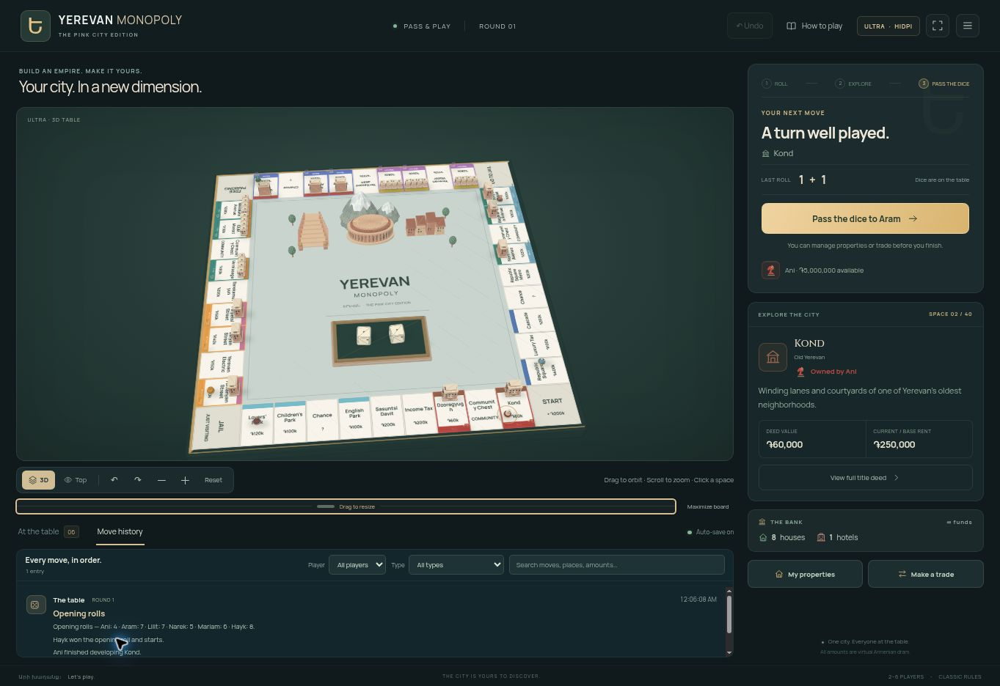

<p align="center">
  
</p>

# Yerevan Monopoly

Yerevan Monopoly is a 3D browser board game for **2–6 players**. Roll the dice, buy properties around Armenia’s capital, and trade with friends. You can play online from separate browsers or pass one computer around the table.

**[Play Yerevan Monopoly online](https://yerevan-monopoly-reza.validapex1.chatgpt.site/)** · [Get the offline game](./public/game/Yerevan-Monopoly-Offline.html)



## Pull up a chair

Choose **Play online**, create a room, and send your friends the invite link or room code. Once at least two players have joined, the host can start the game. Everyone picks an Armenian piece, from a pomegranate or duduk to Mount Ararat or a chess knight.

The board takes you through Kond, past the Cascade, and around Republic Square. Prices are in Armenian dram, and the 3D table has its own tiny hotels, landmarks, and dice tray. You can switch to a top view or use **Find piece** to zoom in on the active piece.

- **Online rooms** include chat, move history, and trade offers players can accept later. You can refresh or rejoin from the same browser. Rooms expire after seven days without a game action.
- **Pass and play** works on one computer, with local saves and JSON import and export. To play without internet access, download the standalone HTML using **Download raw file** on the offline game page and open it in a browser.
- **Classic rules** include auctions, rent, mortgages, jail, doubles, and bankruptcy. Open the in-game handbook when you need to look up a rule.

## Run it locally

You’ll need Node.js 22.13 or later and npm. From the repository root, run:

```sh
npm run setup:local
```

Open [localhost:8787](http://127.0.0.1:8787). The setup installs dependencies when needed, builds the game, and applies D1 migrations before starting Wrangler. To test an online room locally, open a second browser or an incognito window. Your local database lives in `.wrangler/state`.

## Host it on Cloudflare

The project can run on Cloudflare Workers Free with D1, within the plan’s usage limits. Enable your account’s `workers.dev` subdomain first.

```sh
npm ci
npx wrangler login
npm run deploy:cloudflare
```

The script builds the Worker, creates or reuses `online-monopoly-yerevan-db`, and runs the database migrations. Wrangler prints the game’s public URL. Run the same deploy command for updates. Use `npm run deploy:cloudflare -- --dry-run` to check the package before provisioning.

Online rooms poll for game and chat updates, so hosting usage grows with the time players spend in rooms. See [Workers limits](https://developers.cloudflare.com/workers/platform/limits/) and [D1 pricing](https://developers.cloudflare.com/d1/platform/pricing/).

## Inside the project

The board and pieces use Three.js. The browser handles the local game, and the Worker runs the rules for online rooms and saves them in D1. The client is in [public/game](./public/game), the room endpoints are in [app/api/rooms](./app/api/rooms), and the database migrations are in [drizzle](./drizzle).

```sh
npm test
node scripts/make-offline.mjs
```

This is an unofficial fan project. Three.js is distributed under the [MIT license](./public/game/THREE-LICENSE.txt). Manrope and Cinzel use the SIL Open Font License. [Font licenses](./public/game/fonts)
